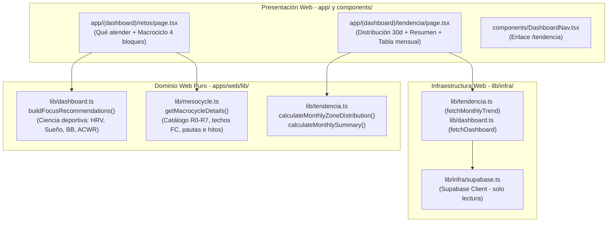

# T-0031 — Entrega de Planificación SDD: Tendencia mensual, macrociclo en 4 bloques y recomendaciones accionables (SPEC-003 / PLAN-003)

## 1. Contexto y propósito

Bajo la disciplina SDD (*Spec-Driven Development*), la constitución del proyecto (`memory/long/constitution.md`) y el rol de Planificador SDD (`planner`), se completó la especificación formal y el plan técnico para la versión **0.5.0 MINOR** de Tri-Coach, atendiendo la cola de requerimientos priorizada por el humano en `memory/immediate/handoff.md`:

1. **«Qué atender» (`/retos`)**: Incorporación de recomendaciones accionables en frases cortas basadas en ciencia deportiva (modulación parasimpática/HRV, higiene y deuda de sueño, recarga autonómica/Body Battery, ratio ACWR de Gabbett < 1.3 y descarga ante sobreesfuerzo/overreaching).
2. **Tarjeta «Macrociclo» (`/retos`)**: Reestructuración en 4 bloques claros: (a) breve descripción de qué es un macrociclo; (b) momento y fase actual (código, nombre, foco, deporte, techo FC en bpm y duración máxima); (c) cómo mejorarla (pauta deportiva práctica contextualizada a la fase activa y adaptada a la fatiga); y (d) cuándo termina (fecha de cierre en formato `es-CO`, días restantes y cuenta regresiva a los hitos de la temporada).
3. **Nueva ruta dedicada `/tendencia` y navegación (`DashboardNav`)**:
   - Retiro de la tarjeta «Tendencia 14d» de `/retos`.
   - Adición del enlace «Tendencia» (`/tendencia`) en la barra lateral `DashboardNav.tsx`.
   - Despliegue en `/tendencia` de una hoja consolidada de los últimos 30 días: barra y conteo de distribución de zonas (`VERDE`, `AMARILLO`, `ROJO`), resumen de métricas clave (HRV, sueño, Body Battery, estrés, ACWR, VO₂max) y tabla mensual detallada con fechas `es-CO` y números tabulares (`font-variant-numeric: tabular-nums`).
4. **Gobernanza arquitectónica**:
   - Regla de dependencia (Clean Architecture, ADR-002, Art. VII.2): funciones puras en `apps/web/lib/`, presentación desacoplada en `app/(dashboard)/` y `components/`.
   - Geometría centrada responsive (ADR-003): contenedor con ancho máximo de 1120px y paddings responsive (28px / 16px).
   - Versionado SemVer `0.5.0` MINOR con reserva serial del grupo `R`.

---

## 2. Inspección del código y estado base

Se inspeccionaron los componentes del sistema para definir interfaces exactas sin riesgo de regresión:

- `apps/web/app/(dashboard)/retos/page.tsx`:
  - Contiene la llamada a `buildFocusItems(readiness, payload)`, el renderizado básico del macrociclo (líneas 83-89) y la tarjeta «Tendencia 14d» (líneas 91-121) con historial de 14 días.
  - El diseño planificado reemplaza la tarjeta «Tendencia 14d», expande «Macrociclo» a 4 bloques con tarjetas semánticas y conecta «Qué atender» con el generador de ciencia deportiva.
- `apps/web/lib/dashboard.ts`:
  - Contiene `buildFocusItems` que actualmente solo emitía alertas cuantitativas simples. Se diseñó la extensión tipada `buildFocusRecommendations` y la preservación de `buildFocusItems` con las frases accionables completas.
- `apps/web/lib/mesocycle.ts`:
  - Mantiene el catálogo de fases `PHASES` y funciones de mesociclo. Se diseñó la extensión del catálogo a los 8 bloques (`R0` a `R7`) con deportes y techos de FC y duración máxima sincronizados con `garmin_coaching/macrocycle.py`, y la función de dominio pura `getMacrocycleDetails`.
- `apps/web/components/DashboardNav.tsx`:
  - Arreglo `LINKS` de 4 elementos. Se planificó la adición de `{ href: "/tendencia", label: "Tendencia" }` entre `/retos` y `/mesociclos`.
- `apps/web/app/globals.css`:
  - Aplica `.app-main > main` con `max-width: 1120px; margin: 0 auto; padding: 1.5rem 28px 3rem;` y `table, .history-table { font-variant-numeric: tabular-nums; }`. La nueva página `/tendencia` se beneficia automáticamente de esta regla global de centrado de ADR-003.

---

## 3. Especificación formal (SPEC-003)

El documento completo fue generado en [`specs/003-tendencia-macrociclo/spec.md`](file:///Users/alarcondiegof/ies-projects/python-garminconnect/specs/003-tendencia-macrociclo/spec.md).

### Resumen de requisitos EARS y pruebas Pxx

| REQ | Patrón | Requisito sintético | Criterio de verificación Pxx |
|---|---|---|---|
| **REQ-001** | Estado | MIENTRAS sueño esté bajo meta, presentar recomendación de higiene circadiana y deuda acumulada. | **P01**: Test unitario valida observación cuantitativa y pauta de descanso/pantallas. |
| **REQ-002** | Estado | MIENTRAS HRV nocturno esté bajo meta, presentar recomendación de modulación parasimpática y contención de intensidad. | **P02**: Test unitario valida recomendación de recuperación Z1, tono vagal y respiración. |
| **REQ-003** | Estado | MIENTRAS Body Battery nocturno sea insuficiente, presentar pauta de recarga autonómica y mitigación de estresores nocturnos. | **P03**: Test unitario valida pauta contra comidas tardías/alcohol y entorno de descanso. |
| **REQ-004** | Estado | MIENTRAS ACWR > 1.3, presentar recomendación de prevención de lesiones orientada a descarga según Gabbett. | **P04**: Test unitario valida reducción semanal de volumen (20-30%) y contención de intensidad. |
| **REQ-005** | Estado | MIENTRAS status sea OVERREACHING, prescribir descarga activa obligatoria ante fatiga no funcional. | **P05**: Test unitario valida prescripción de 24-48 h de descarga o rodajes Z1 regenerativos. |
| **REQ-006** | Estado | MIENTRAS indicadores estén en VERDE, emitir recomendación afirmativa de confirmación y ejecución de sesión. | **P06**: Test unitario confirma autorización deportiva positiva en zona VERDE. |
| **REQ-007** | Ubicuo | Estructurar tarjeta Macrociclo en 4 bloques claramente delimitados (definición, fase, optimización, timing). | **P07**: Inspección y render en `/retos` comprueba existencia y orden de los 4 bloques. |
| **REQ-008** | Estado | MIENTRAS se visualice bloque A, exponer qué es un macrociclo en periodización hacia mmB, Letras y 70.3. | **P08**: Test comprueba explicación pedagógica de planificación estratégica plurianual. |
| **REQ-009** | Estado | MIENTRAS se visualice bloque B, detallar código, nombre, foco, deporte, techo FC y duración máxima. | **P09**: Test unitario comprueba campos de fase activa para R1 (135 bpm, 75 min, etc.). |
| **REQ-010** | Estado | MIENTRAS se visualice bloque C, emitir pauta deportiva práctica adaptada a fase activa y estado de fatiga. | **P10**: Test unitario comprueba disciplina en Z1-Z2 y ajuste según zona de readiness. |
| **REQ-011** | Estado | MIENTRAS se visualice bloque D, mostrar fecha fin en `es-CO`, días restantes e hitos de la temporada. | **P11**: Test unitario formatea fin de fase (ej. 31 dic 2026), días restantes y cuenta regresiva a eventos. |
| **REQ-012** | Evento | CUANDO se acceda a `/retos`, omitir tarjeta Tendencia 14d preservando las demás secciones. | **P12**: Test de markup confirma retiro de tabla de 14 filas y estabilidad de otras secciones. |
| **REQ-013** | Ubicuo | Incluir ítem `/tendencia` en DashboardNav con etiqueta «Tendencia» y resaltado activo. | **P13**: Test de `DashboardNav` comprueba enlace, etiqueta y `aria-current="page"`. |
| **REQ-014** | Evento | CUANDO se navegue a `/tendencia`, desplegar contenedor centrado max-width 1120px (ADR-003). | **P14**: Test de layout valida envoltorio `.app-main > main` con paddings 28px/16px. |
| **REQ-015** | Estado | MIENTRAS se visualice `/tendencia`, mostrar barra horizontal y conteo/porcentaje de zonas VERDE/AMARILLO/ROJO en 30d. | **P15**: Test unitario de distribución calcula proporciones y conteos exactos sobre 30 días. |
| **REQ-016** | Estado | MIENTRAS se visualice `/tendencia`, presentar resumen consolidado con promedios de HRV, sueño, BB, estrés, ACWR y VO₂max. | **P16**: Test unitario de `calculateMonthlySummary` valida promedios y omisión limpia de nulos. |
| **REQ-017** | Estado | MIENTRAS se visualice `/tendencia`, presentar tabla de 30 días con fechas `es-CO`, badges y `tabular-nums`. | **P17**: Test de componente y estilos comprueba fechas localizadas y tipografía tabular. |
| **REQ-018** | No deseado | SI consulta a Supabase falla o lista está vacía, ENTONCES mostrar estado vacío amigable sin excepciones. | **P18**: Test de contingencia verifica renderizado amigable sin romper la página. |
| **REQ-019** | Ubicuo | Implementar toda la lógica de cálculo y agregación en funciones puras en `apps/web/lib/` (Clean Architecture). | **P19**: Test de arquitectura comprueba pureza sin imports de React, Next ni Supabase en cálculo. |
| **REQ-020** | Ubicuo | Declarar versión SemVer 0.5.0 MINOR sincronizada en grupo R (package, lock, version.test, README, CHANGELOG). | **P20**: Suite de versión valida 0.5.0 coherente sin degradación desde 0.4.0. |

---

## 4. Plan técnico (PLAN-003)

El documento completo fue generado en [`specs/003-tendencia-macrociclo/plan.md`](file:///Users/alarcondiegof/ies-projects/python-garminconnect/specs/003-tendencia-macrociclo/plan.md).

### Arquitectura técnica (Clean Architecture, ADR-002 y ADR-007)



### Descomposición en tasks hijas y allowlists disjuntas

| Task ID (alias) | Destino | REQ cubiertos | Allowlist de archivos (estrictamente disjunta) | Depende de | Perfil |
|---|---|---|---|---|---|
| **T-0032**<br>`(I-DOMAIN-RETOS)` | implementer | REQ-001..<br>REQ-012 | `apps/web/lib/dashboard.ts`<br>`apps/web/lib/mesocycle.ts`<br>`apps/web/app/(dashboard)/retos/page.tsx`<br>`apps/web/tests/tendencia-macrociclo/recommendations.test.mjs`<br>`apps/web/tests/tendencia-macrociclo/macrocycle.test.mjs`<br>`deliverables/T-0032.md` | Gate G0 aprobado por humano | riguroso |
| **T-0033**<br>`(I-TENDENCIA-NAV)` | implementer | REQ-013..<br>REQ-019 | `apps/web/lib/tendencia.ts`<br>`apps/web/components/DashboardNav.tsx`<br>`apps/web/app/(dashboard)/tendencia/page.tsx`<br>`apps/web/app/globals.css`<br>`apps/web/tests/tendencia-macrociclo/trend-monthly.test.mjs`<br>`apps/web/tests/tendencia-macrociclo/architecture.test.mjs`<br>`deliverables/T-0033.md` | T-0032 aprobada e integrada | riguroso |
| **T-0034**<br>`(I-RELEASE-050)` | implementer | REQ-020 | `apps/web/package.json`<br>`apps/web/package-lock.json`<br>`apps/web/lib/version.test.mjs`<br>`apps/web/README.md`<br>`apps/web/CHANGELOG.md`<br>`apps/web/lib/tendencia-macrociclo.test.mjs`<br>`deliverables/T-0034.md` | T-0033 aprobada e integrada | riguroso |
| **T-0035**<br>`(V-INTEGRAL-050)` | viewer | Todos<br>(REQ-001..020) | Solo lectura (`deliverables/T-0035.md`) | T-0034 completada | riguroso |

---

## 5. Justificación de bloques SDLC

- **Requisitos (`cubierto`)**: Redactada la especificación formal `specs/003-tendencia-macrociclo/spec.md` con 20 requisitos EARS cerrados, prioridades, no-objetivos precisos y criterios de prueba P01 a P20 verificables por máquina.
- **Diseño (`cubierto`)**: Redactado el plan técnico `specs/003-tendencia-macrociclo/plan.md` con análisis de alternativas, Clean Architecture según `standards.md`, propuesta formal de ADR-007, contratos tipados en TypeScript y descomposición de tasks con allowlists disjuntas.
- **Implementación (`no-aplica`)**: El rol Planificador (`planner`) tiene estrictamente prohibido redactar código de producción o modificar `apps/web/`. La implementación corresponde a las tasks T-0032, T-0033 y T-0034.
- **Pruebas (`cubierto`)**: Diseñada la matriz de trazabilidad integral asignando cada requisito EARS a una suite específica en `apps/web/tests/tendencia-macrociclo/` y al runner principal `tendencia-macrociclo.test.mjs`.
- **Release (`no-aplica`)**: La publicación de la release es potestad humana. El plan define la versión objetivo SemVer `0.5.0` MINOR y reserva el grupo `R` de forma serial.
- **Despliegue (`no-aplica`)**: El rol Planner no ejecuta despliegues a Vercel ni mutaciones cloud. Se redactó la Sección 8 de PLAN-003 con la guía operativa detallada paso a paso para el operador humano.
- **Operación-mantenimiento (`cubierto`)**: Definidas las métricas de observabilidad en operación (errores HTTP 5xx < 0.1%, latencias < 400 ms, verificación del botón Actualizar y condiciones de reapertura de la spec).
- **Seguridad (`cubierto`)**: Declarada la política de cero secretos nuevos, operación en solo lectura sobre tablas existentes de Supabase, preservación de aislamiento RLS y uso exclusivo de datos sintéticos en suites de test.

---

## 6. Propuesta cerrada para Gate G0 (Decisión requerida)

Se solicita al operador humano la aprobación formal de la especificación **SPEC-003** y el plan **PLAN-003** mediante el comando reglamentario de IES CLI:

```bash
IES_ACTOR=coordinator ies spec approve 003-tendencia-macrociclo --decision-ref memory/mid/decisions.md#dec-010-aprobacion-humana-g0-de-spec-003-y-plan-003
```

Al otorgarse la aprobación humana:
1. Coordinator registrará la decisión DEC-010 en `memory/mid/decisions.md`.
2. Las especificaciones `specs/003-tendencia-macrociclo/spec.md` y `specs/003-tendencia-macrociclo/plan.md` quedarán formalmente aprobadas y congeladas.
3. Se autorizará el despacho secuencial de las tasks implementer (`T-0032`, `T-0033`, `T-0034`) y viewer (`T-0035`) en worktrees aislados.
