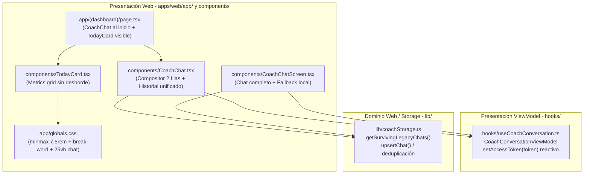

# T-0036 — Entrega de Planificación SDD: Corrección de desborde métricas, jerarquía de chat e historial de conversaciones (SPEC-004 / PLAN-004)

## 1. Contexto y propósito

Bajo la disciplina SDD (*Spec-Driven Development*), la constitución del proyecto (`memory/long/constitution.md`) y el rol de Planificador SDD (`planner`), se completó la especificación formal y el plan técnico para la versión **0.5.1 PATCH** de Tri-Coach, atendiendo la cola de correcciones prioritarias solicitadas por el usuario en `memory/immediate/handoff.md`:

1. **Corrección de desborde visual en subcomponente «PUNTUACIÓN DE SUEÑO»** (`apps/web/app/globals.css`, `apps/web/components/TodayCard.tsx`):
   - Eliminar el solapamiento del check verde `✓` sobre la tarjeta contigua de `HRV` mediante ajuste de `.metrics-grid` a `repeat(auto-fit, minmax(7.5rem, 1fr))`, contención flexible con `min-width: 0; overflow: hidden;` en `.metric-cell`, alineación vertical `align-items: flex-start; gap: 0.35rem; min-width: 0;` en `.metric-label-row`, quiebre seguro de palabra indivisible con `overflow-wrap: break-word; line-height: 1.25; min-width: 0; flex: 1 1 auto;` en `.metric-label`, y badge rígido con `flex-shrink: 0;` en `.metric-status-badge`.
   - Garantizar cumplimiento de la regla geométrica `scrollWidth <= clientWidth` en cualquier ancho de pantalla entre 375px y 1600px.

2. **Posicionamiento y dimensionamiento compacto de CoachChat en Inicio** (`apps/web/app/(dashboard)/page.tsx`, `apps/web/app/globals.css`, `apps/web/components/CoachChat.tsx`):
   - Mover `<CoachChat />` como primer componente interactivo inmediatamente después de `<header className="page-header">` y antes de `<TodayCard />` (revocando el orden anterior de T-0013 por directriz humana explícita).
   - Acotar la altura de `.coach-chat` en Inicio a ~22vh-25vh (min 180px, max 28vh), con textarea compacto de 2 filas y scroll vertical interno para el listado de conversaciones recientes, manteniendo visible la tarjeta `<TodayCard />` inmediatamente debajo sin requerir desplazamiento excesivo.

3. **Restauración y sincronización reactiva del historial de conversaciones** (`apps/web/hooks/useCoachConversation.ts`, `apps/web/components/CoachChat.tsx`, `apps/web/components/CoachChatScreen.tsx`, `apps/web/lib/coachStorage.ts`):
   - En `CoachConversationViewModel`: permitir actualizar dinámicamente `accessToken` (`vm.setAccessToken(options.accessToken ?? null)`) cada vez que cambie la sesión y sincronizarlo reactivamente mediante `useEffect([options.accessToken])`.
   - Capturar respuestas no exitosas (401 o 500) en `loadConversations()` sin lanzar excepciones no controladas ni dejar cargas fantasmas.
   - En `CoachChat.tsx` y `CoachChatScreen.tsx`: unificar y deduplicar en presentación las conversaciones remotas con las conversaciones locales supervivientes (`getSurvivingLegacyChats()` en `localStorage["fitness-coach-chats"]`).
   - Soportar la apertura y lectura de conversaciones locales en `CoachChatScreen` con fallback local ante ausencia de autenticación remota o error de red.
   - Persistir de forma inmediata una copia de respaldo en `localStorage` con `upsertChat` cada vez que se envía o recibe un mensaje en el chat.

4. **Versionado sincronizado SemVer 0.5.1 PATCH** en Grupo R (`package.json`, `package-lock.json`, `README.md`, `CHANGELOG.md`, `version.test.mjs`).

---

## 2. Inspección del código y diagnóstico de causa raíz

Se inspeccionaron detalladamente los componentes y estilos afectados:

1. **`apps/web/app/globals.css` (líneas 665-685, 833-862)**:
   - `.metrics-grid` declaraba `repeat(auto-fill, minmax(5.5rem, 1fr))`. 5.5rem equivale a ~88 px.
   - `.metric-cell` tenía padding de `0.5rem 0.65rem` (20.8 px horizontales), dejando ~67 px de ancho útil.
   - La palabra indivisible en mayúsculas `PUNTUACIÓN` mide ~76 px a 0.7rem. Al carecer de `min-width: 0` y `overflow-wrap: break-word`, y estar acompañada en la misma fila del badge `✓` (`.metric-status-badge`) sin `flex-shrink: 0`, empujaba el badge fuera del margen derecho de la celda.
   - La solución planificada amplía a `minmax(7.5rem, 1fr)` (120 px mínimos), aplica `min-width: 0; overflow: hidden;` en la celda, `flex-shrink: 0` en el badge y `overflow-wrap: break-word; line-height: 1.25;` en la etiqueta.

2. **`apps/web/app/(dashboard)/page.tsx` (líneas 88-120)**:
   - `<CoachChat />` se encontraba al fondo, después de `<TodayCard />`, `<LastActivityCard />` y `<RecoveryMilestonesCard />`.
   - La reestructuración sitúa `<CoachChat />` inmediatamente bajo `<header className="page-header">`.
   - En `globals.css`, se acota `.coach-chat` a `min-height: 180px; max-height: 28vh;` con textarea de 2 filas y scroll interno en historial para no ocultar `<TodayCard />`.

3. **`apps/web/hooks/useCoachConversation.ts` (líneas 48-121, 130-170, 398-445)**:
   - `CoachConversationViewModel` guardaba `private readonly accessToken: string | null` en su constructor.
   - `useCoachConversation` instanciaba `vmRef.current` únicamente en el primer render, cuando `accessToken` aún era `null`. Cuando `authService.getSession()` resolvía el token JWT real, `vmRef.current` jamás recibía el nuevo token, enviando todas las peticiones remotas con encabezados vacíos y recibiendo `401`.
   - Adicionalmente, `loadConversations()` evaluaba `if (res.ok)` sin rama alternativa ante `401`, dejando la lista vacía en silencio.
   - Se diseñó el método `setAccessToken(token: string | null)` y la sincronización reactiva en `useEffect([options.accessToken])`.

4. **`apps/web/components/CoachChat.tsx` y `CoachChatScreen.tsx`**:
   - Omitían por completo la lectura de conversaciones locales supervivientes (`getSurvivingLegacyChats()` en `coachStorage.ts`). Si el usuario no tenía sesión cloud, «Últimas conversaciones» aparecía vacío.
   - Se diseñó la lógica de deduplicación y merge para mostrar todas las conversaciones (locales y remotas), permitiendo abrirlas directamente en `/chat?conversation=<id>`.

---

## 3. Especificación formal (SPEC-004)

El documento completo fue generado en [`specs/004-patch-layout-chat/spec.md`](file:///Users/alarcondiegof/ies-projects/python-garminconnect/specs/004-patch-layout-chat/spec.md).

### Resumen de requisitos EARS y pruebas Pxx

| REQ | Patrón | Requisito sintético | Criterio de verificación Pxx |
|---|---|---|---|
| **REQ-001** | Ubicuo | Renderizar `.metrics-grid` y celdas sin desbordamiento horizontal (`scrollWidth <= clientWidth`) en todo viewport entre 375px y 1600px. | **P01**: Test geométrico automatizado verifica contención en resoluciones clave para la celda `PUNTUACIÓN DE SUEÑO`. |
| **REQ-002** | Ubicuo | Aplicar `minmax(7.5rem, 1fr)`, contención `min-width: 0; overflow: hidden;`, `overflow-wrap: break-word`, `line-height: 1.25` y `flex-shrink: 0`. | **P02**: Test automatizado de CSS sobre `apps/web/app/globals.css` valida las reglas exactas. |
| **REQ-003** | Ubicuo | Posicionar `<CoachChat />` como primer bloque interactivo bajo `<header className="page-header">` y antes de `<TodayCard />`. | **P03**: Test de AST/marcado JSX de `page.tsx` verifica jerarquía visual de componentes dentro de `<main>`. |
| **REQ-004** | Estado | MIENTRAS se visualice `CoachChat` en Inicio, acotar altura a ~22vh-25vh (min 180px, max 28vh), compositor de 2 filas y scroll en historial. | **P04**: Test de reglas CSS e inspección de componente verifica cotas de altura y visibilidad de `TodayCard`. |
| **REQ-005** | Evento | CUANDO `accessToken` cambie o se resuelva reactivamente, actualizar `CoachConversationViewModel` con `setAccessToken` y recargar lista. | **P05**: Test unitario comprueba actualización de encabezados `Authorization: Bearer <token>` tras resolver la sesión. |
| **REQ-006** | No deseado | SI petición a `/api/conversations` o `/api/chat` retorna 401 o 500, ENTONCES capturar limpiamente sin crash y permitir fallback local. | **P06**: Test unitario en `CoachConversationViewModel` comprueba manejo de errores y estado `isLoading: false`. |
| **REQ-007** | Ubicuo | Presentar lista unificada y deduplicada de conversaciones remotas y locales (`localStorage["fitness-coach-chats"]`) en Inicio y ChatScreen. | **P07**: Test unitario valida deduplicación y navegación fluida a `/chat?conversation=<id>`. |
| **REQ-008** | Evento | CUANDO se cree conversación o envíe mensaje, persistir copia de respaldo inmediata en `localStorage` con `upsertChat`. | **P08**: Test de almacenamiento comprueba actualización inmediata en `localStorage["fitness-coach-chats"]`. |
| **REQ-009** | Ubicuo | Declarar versión SemVer `0.5.1` (PATCH) sincronizada en Grupo R (`package.json`, lock, `version.test.mjs`, `README.md`, `CHANGELOG.md`). | **P09**: Suite de versión valida `0.5.1` atómica y entrada en `CHANGELOG.md`. |

---

## 4. Plan técnico (PLAN-004)

El documento completo fue generado en [`specs/004-patch-layout-chat/plan.md`](file:///Users/alarcondiegof/ies-projects/python-garminconnect/specs/004-patch-layout-chat/plan.md).

### Arquitectura técnica (Clean Architecture y ADR-008 propuesto)



### Descomposición en tasks hijas y allowlists

| Task ID (alias) | Destino | REQ cubiertos | Allowlist de archivos (acotada) | Depende de | Perfil |
|---|---|---|---|---|---|
| **T-0037**<br>`(I-PATCH-051)` | implementer | REQ-001..<br>REQ-009 | `apps/web/app/globals.css`<br>`apps/web/components/TodayCard.tsx`<br>`apps/web/app/(dashboard)/page.tsx`<br>`apps/web/components/CoachChat.tsx`<br>`apps/web/components/CoachChatScreen.tsx`<br>`apps/web/hooks/useCoachConversation.ts`<br>`apps/web/lib/coachStorage.ts`<br>`apps/web/package.json`<br>`apps/web/package-lock.json`<br>`apps/web/README.md`<br>`apps/web/CHANGELOG.md`<br>`apps/web/lib/version.test.mjs`<br>`apps/web/tests/patch-layout-chat/*.test.mjs`<br>`apps/web/lib/patch-layout-chat.test.mjs`<br>`deliverables/T-0037.md` | Gate G0 aprobado por humano | fast-track |
| **T-0038**<br>`(V-VIEWER-051)` | viewer | Todos<br>(REQ-001..009) | Solo lectura (`deliverables/T-0038.md`) | T-0037 completada | riguroso |

---

## 5. Justificación de bloques SDLC

- **Requisitos (`cubierto`)**: Redactada la especificación formal `specs/004-patch-layout-chat/spec.md` con 9 requisitos EARS cerrados, prioridades, no-objetivos precisos y criterios de prueba P01 a P09 verificables por máquina.
- **Diseño (`cubierto`)**: Redactado el plan técnico `specs/004-patch-layout-chat/plan.md` con análisis de alternativas, Clean Architecture según `standards.md`, propuesta formal de ADR-008, contratos tipados en TypeScript y descomposición en tasks hijas.
- **Implementación (`no-aplica`)**: El rol Planificador (`planner`) tiene estrictamente prohibido redactar código de producción o modificar `apps/web/`. La implementación corresponde a la task T-0037.
- **Pruebas (`cubierto`)**: Diseñada la matriz de trazabilidad integral asignando cada requisito EARS a una suite específica en `apps/web/tests/patch-layout-chat/` y al runner de pruebas del paquete.
- **Release (`no-aplica`)**: La publicación de la release es potestad humana. El plan define la versión objetivo SemVer `0.5.1` PATCH y reserva el grupo `R` de forma serial en T-0037.
- **Despliegue (`no-aplica`)**: El rol Planner no ejecuta despliegues a Vercel ni mutaciones cloud. Se redactó la Sección 8 de PLAN-004 con la guía operativa detallada paso a paso para el operador humano.
- **Operación-mantenimiento (`cubierto`)**: Definidas las métricas de observabilidad en operación (0 errores 500 en `/` y `/chat`, tasa de respuesta 200 en endpoints de chat, latencia < 300 ms y condiciones de reapertura de la spec).
- **Seguridad (`cubierto`)**: Declarada la política de cero secretos nuevos, token JWT exclusivamente en memoria/encabezados estándar `Authorization: Bearer`, y preservación no destructiva byte a byte del almacenamiento local `localStorage["fitness-coach-chats"]`.

---

## 6. Propuesta cerrada para Gate G0 (Decisión requerida)

Se solicita al operador humano la aprobación formal de la especificación **SPEC-004** y el plan **PLAN-004** mediante el comando reglamentario de IES CLI:

```bash
IES_ACTOR=coordinator ies spec approve 004-patch-layout-chat --decision-ref memory/mid/decisions.md#dec-011-aprobacion-humana-g0-de-spec-004-y-plan-004
```

Al otorgarse la aprobación humana:
1. Coordinator registrará la decisión DEC-011 en `memory/mid/decisions.md`.
2. Las especificaciones `specs/004-patch-layout-chat/spec.md` y `specs/004-patch-layout-chat/plan.md` quedarán formalmente aprobadas y congeladas.
3. Se autorizará el despacho secuencial de la task implementer (`T-0037`) y viewer (`T-0038`) en worktree aislado.
