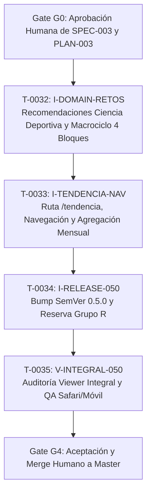

# PLAN-003: Tendencia mensual, macrociclo en 4 bloques y recomendaciones accionables de ciencia deportiva

- **Origen**: Instrucción humana en HITL - Tri-Coach (`memory/immediate/handoff.md`), task T-0031.
- **Autonomía**: `hitl` (requiere aprobación humana G0 antes de iniciar la implementación).
- **Versión objetivo**: SemVer `0.5.0` MINOR.

---

## 1. Decisión técnica y alternativas

### Evaluación de alternativas

| Área | Alternativas evaluadas | Complejidad, riesgo, costo y reversibilidad |
|---|---|---|
| **Recomendaciones en «Qué atender»** | **1. Strings ad-hoc en componente React** vs<br>**2. Generador puro tipado en dominio (`apps/web/lib/dashboard.ts`)** | La opción 1 acopla lógica deportiva a la vista y dificulta tests; **Opción 2 recomendada**: complejidad baja, riesgo mínimo, costo de mantenimiento bajo, 100% testeable en aislamiento y completamente reversible. |
| **Tarjeta Macrociclo** | **1. Renderizado estático en `retos/page.tsx`** vs<br>**2. Módulo de dominio enriquecido en `apps/web/lib/mesocycle.ts` sincronizado con Python** | La opción 1 duplicaría o falsearía datos de fase; **Opción 2 recomendada**: sincroniza el catálogo canónico (R0-R7, techos FC, duración máxima, hitos mayores) en TypeScript puro, desacopla la presentación y provee recomendaciones de ejecución coherentes con el estado del atleta. |
| **Ruta `/tendencia` y avances mensuales** | **1. Client Component con fetch en `useEffect`** vs<br>**2. Server Component con módulo de cálculo puro (`apps/web/lib/tendencia.ts`)** | La opción 1 introduce waterfalls de red, parpadeos y acopla estado al cliente; **Opción 2 recomendada**: aprovecha Next.js 15 Server Components, consulta datos en paralelo en servidor, delega el cálculo a funciones puras sin dependencias de red/UI y respeta el contenedor centrado de 1120px (ADR-003). |
| **Estrategia de versionado** | **1. Entregas separadas tipo PATCH (0.4.1, 0.4.2)** vs<br>**2. Paquete integral SemVer 0.5.0 MINOR** | La opción 1 fragmenta la entrega y genera overhead en el ledger; **Opción 2 recomendada**: una versión MINOR unificada (`0.5.0`) que introduce la nueva ruta `/tendencia` y enriquece macrociclo y recomendaciones de forma coherente. |

### ADR propuesto

```markdown
# ADR-007: Macrociclo en 4 bloques, recomendaciones de ciencia deportiva y agregación de tendencia mensual en Clean Architecture

- Estado: propuesto
- Fecha: 2026-10-17
- Task: T-0031 (especificación), dependiente de aprobación G0

## Contexto
El dashboard de Tri-Coach requiere prescribir recomendaciones accionables basadas en investigación fisiológica (modulación parasimpática, cronobiología del sueño, recarga autonómica y ratio ACWR de Gabbett), enriquecer la tarjeta Macrociclo en 4 bloques (definición, fase actual con techos FC/duración, optimización práctica y finalización en es-CO con hitos), y trasladar la tendencia de 14 días a una página mensual dedicada (/tendencia) con distribución de zonas y resumen fisiológico consolidado.

## Decisión
1. Mantener estricto cumplimiento de Clean Architecture (ADR-002, regla de dependencia):
   - Dominio web: funciones puras de cálculo matemático, clasificación de zonas, agregación estadística y recomendaciones en apps/web/lib/ (tendencia.ts, mesocycle.ts, dashboard.ts) sin imports de React, Next ni Supabase.
   - Infraestructura web: apps/web/lib/infra/supabase.ts gestiona exclusivamente el I/O con la base de datos cloud.
   - Presentación web: Server Components en apps/web/app/(dashboard)/ y client components interactivos.
2. Adoptar el contenedor centrado (ADR-003) para la nueva ruta /tendencia, heredando el ancho máximo de 1120px y paddings de 28px/16px a través del shell (.app-main > main).
3. Gestionar los avances mensuales en base a los últimos 30 días naturales disponibles en readiness_daily y training_load para el usuario MVP, tolerando datos parciales sin lanzar excepciones.
4. Incrementar la versión del paquete a 0.5.0 MINOR de forma atómica en el grupo R.

## Consecuencias
- Desacoplamiento total entre las reglas fisiológicas y la UI.
- Cobertura de tests unitarios puros para todas las métricas de ciencia deportiva.
- Navegación optimizada sin sobrecargar la pantalla operativa de /retos.
- Cero migraciones SQL en producción; utiliza exclusivamente los datos ya persistidos.
```

---

## 2. Componentes, capas y contrato técnico (Clean Architecture P22)

### Asignación de capas (`memory/long/standards.md`)

| Capa | Componente | Responsabilidad | Dependencias permitidas |
|---|---|---|---|
| **Dominio web** | `apps/web/lib/dashboard.ts` (extensión de recomendaciones) | Funciones puras `buildFocusRecommendations` y `buildFocusItems` que aplican reglas fisiológicas de ciencia deportiva. | Solo TypeScript stdlib; ningún framework ni I/O. |
| **Dominio web** | `apps/web/lib/mesocycle.ts` (extensión de macrociclo) | Catálogo de fases `PHASES_CATALOG`, función pura `getMacrocycleDetails` (definición, fase activa con techos FC/duración, recomendación práctica e hitos temporales). | Solo TypeScript stdlib y date helpers puros. |
| **Dominio web** | `apps/web/lib/tendencia.ts` (cálculo puro) | Funciones puras `calculateMonthlyZoneDistribution`, `calculateMonthlySummary` y `formatMonthlyTrendRows`. | Solo TypeScript stdlib y date helpers puros. |
| **Infraestructura web** | `apps/web/lib/tendencia.ts` (función adaptadora) | Función `fetchMonthlyTrend(userId)` que consulta `readiness_daily` (limit 30) y `training_load` (limit 60) vía Supabase y enlaza los datos. | `apps/web/lib/infra/supabase.ts`. |
| **Presentación web** | `apps/web/components/DashboardNav.tsx` | Menú lateral responsive que incluye el enlace `/tendencia` con estado activo. | Next.js navigation, React. |
| **Presentación web** | `apps/web/app/(dashboard)/retos/page.tsx` | Server Component que retira "Tendencia 14d", renderiza "Qué atender" enriquecido y despliega la tarjeta "Macrociclo" en 4 bloques. | Funciones de dominio de `lib/`, componentes UI. |
| **Presentación web** | `apps/web/app/(dashboard)/tendencia/page.tsx` | Server Component de la nueva ruta que orquesta y despliega la distribución de zonas, resumen de métricas y tabla de 30 días. | `lib/tendencia.ts`, `globals.css`. |

### Contratos e interfaces TypeScript

#### 1. Recomendaciones accionables de ciencia deportiva (`apps/web/lib/dashboard.ts`)

```typescript
export type FocusSeverity = "warning" | "danger" | "info";

export type FocusRecommendation = {
  metric: "sleep" | "sleep_score" | "hrv" | "bb_change" | "acwr" | "overreaching" | "all_aligned";
  severity: FocusSeverity;
  observation: string;     // Ej: "Sueño 5.8 h — meta ≥7.0 h"
  recommendation: string;  // Ej: "Mitiga la deuda de sueño: adelanta 45 min la hora de acostarte y elimina pantallas 1 h antes."
  fullText: string;        // Ej: "Sueño 5.8 h (meta ≥7.0 h) — Mitiga la deuda de sueño: adelanta la hora de acostarte y retira pantallas 1 h antes."
};

export function buildFocusRecommendations(
  readiness: ReadinessRow | null,
  payload: SnapshotPayload
): FocusRecommendation[];

// Mantiene compatibilidad regresiva devolviendo string[] con las recomendaciones completas
export function buildFocusItems(
  readiness: ReadinessRow | null,
  payload: SnapshotPayload
): string[];
```

#### 2. Tarjeta Macrociclo en 4 bloques (`apps/web/lib/mesocycle.ts`)

```typescript
export type MacrocycleBlockData = {
  // Bloque A: Definición pedagógica
  definition: {
    title: string;
    text: string;
  };
  // Bloque B: Momento y fase actual
  currentPhase: {
    code: string;               // Ej: "R1"
    name: string;               // Ej: "Base aeróbica"
    focus: string;              // Ej: "80/20 Z1-Z2"
    sport: string;              // Ej: "run+bike"
    hrCap: number;              // Ej: 135 bpm
    maxDurationMin: number;     // Ej: 75 min
    startDate: string;          // ISO YYYY-MM-DD
    endDate: string;            // ISO YYYY-MM-DD
  };
  // Bloque C: Cómo mejorarla (pauta deportiva práctica)
  howToImprove: {
    title: string;
    recommendation: string;     // Contextualizada a la fase activa y adaptada a fatiga/ACWR
  };
  // Bloque D: Cuándo termina
  timing: {
    phaseEndDateFormatted: string;   // Ej: "31 dic 2026" (es-CO)
    daysRemainingPhase: number;      // Ej: 75
    milestones: Array<{
      code: string;
      name: string;
      eventDateFormatted: string;    // Ej: "25 jul 2027" (es-CO)
      daysRemaining: number;
    }>;
  };
};

export function getMacrocycleDetails(
  onDateIso: string,
  payloadMacrocycle?: SnapshotPayload["macrocycle"],
  milestones?: SnapshotPayload["milestones"],
  readinessZone?: string,
  acwr?: number | null
): MacrocycleBlockData;
```

#### 3. Tendencia mensual y avances (`apps/web/lib/tendencia.ts`)

```typescript
export type MonthlyTrendRow = {
  date: string;               // YYYY-MM-DD
  dateFormatted: string;      // Formato es-CO: "17 oct 2026"
  zone: "VERDE" | "AMARILLO" | "ROJO" | string;
  scoreOk: number | null;
  hrv: number | null;
  sleepHours: number | null;
  sleepScore: number | null;
  stress: number | null;
  bbChange: number | null;
  acwr: number | null;
  vo2max: number | null;
};

export type MonthlyZoneDistribution = {
  totalDays: number;
  counts: { VERDE: number; AMARILLO: number; ROJO: number };
  percentages: { VERDE: number; AMARILLO: number; ROJO: number };
};

export type MetricSummaryItem = {
  label: string;
  averageValue: number | null;
  unit: string;
  target?: string;
  statusLabel: string;
};

export type MonthlySummary = {
  totalEvaluatedDays: number;
  zoneCompliancePct: number;    // % de días en VERDE
  hrv: MetricSummaryItem;
  sleepHours: MetricSummaryItem;
  sleepScore: MetricSummaryItem;
  bodyBatteryChange: MetricSummaryItem;
  stress: MetricSummaryItem;
  acwr: MetricSummaryItem;
  vo2max: MetricSummaryItem;
};

export function calculateMonthlyZoneDistribution(
  rows: Array<{ zone: string }>
): MonthlyZoneDistribution;

export function calculateMonthlySummary(
  rows: MonthlyTrendRow[],
  thresholds?: Record<string, number>
): MonthlySummary;

export async function fetchMonthlyTrend(
  userId?: string
): Promise<{
  rows: MonthlyTrendRow[];
  distribution: MonthlyZoneDistribution;
  summary: MonthlySummary;
  error?: string | null;
}>;
```

---

## 3. Dimensionamiento del equipo y autonomía

- **Autonomía**: `hitl` (cada transición relevante de gate y el merge a `master` exigen autorización humana).
- **Tamaño de equipo**: **M ajustado** (2 Implementers técnicos especializados, 1 Implementer de release serializado, 1 Viewer integral independiente, y el Coordinator principal).
- **Justificación**:
  - T-DOMAIN-RETOS y T-TENDENCIA-NAV tocan subsistemas con dependencias lógicas claras. Se ejecutan de manera serializada o con allowlists disjuntas para evitar colisiones de archivos.
  - La reserva serial del grupo `R` (`package.json`, `package-lock.json`, `CHANGELOG.md`, `README.md`, `version.test.mjs`) garantiza la coherencia estricta de la versión `0.5.0` sin drift.
  - Un único Viewer integral audita la solución completa con pruebas de geometría Safari/móvil, cobertura unitaria y Clean Architecture.

---

## 4. Descomposición en tasks y allowlists

Todas las tasks hijas tienen `parent_task: T-0031` y perfil `riguroso`.



### Tabla de tasks propuestas

| Task ID (alias) | Destino | REQ cubiertos | Allowlist de archivos (disjunta) | Depende de | Perfil |
|---|---|---|---|---|---|
| **T-0032**<br>`(I-DOMAIN-RETOS)` | implementer | REQ-001..<br>REQ-012 | `apps/web/lib/dashboard.ts`<br>`apps/web/lib/mesocycle.ts`<br>`apps/web/app/(dashboard)/retos/page.tsx`<br>`apps/web/tests/tendencia-macrociclo/recommendations.test.mjs`<br>`apps/web/tests/tendencia-macrociclo/macrocycle.test.mjs`<br>`deliverables/T-0032.md` | Gate G0 aprobado por humano | riguroso |
| **T-0033**<br>`(I-TENDENCIA-NAV)` | implementer | REQ-013..<br>REQ-019 | `apps/web/lib/tendencia.ts`<br>`apps/web/components/DashboardNav.tsx`<br>`apps/web/app/(dashboard)/tendencia/page.tsx`<br>`apps/web/app/globals.css`<br>`apps/web/tests/tendencia-macrociclo/trend-monthly.test.mjs`<br>`apps/web/tests/tendencia-macrociclo/architecture.test.mjs`<br>`deliverables/T-0033.md` | T-0032 aprobada e integrada | riguroso |
| **T-0034**<br>`(I-RELEASE-050)` | implementer | REQ-020 | `apps/web/package.json`<br>`apps/web/package-lock.json`<br>`apps/web/lib/version.test.mjs`<br>`apps/web/README.md`<br>`apps/web/CHANGELOG.md`<br>`apps/web/lib/tendencia-macrociclo.test.mjs`<br>`deliverables/T-0034.md` | T-0033 aprobada e integrada | riguroso |
| **T-0035**<br>`(V-INTEGRAL-050)` | viewer | Todos<br>(REQ-001..020) | Solo lectura (`deliverables/T-0035.md`) | T-0034 completada | riguroso |

> [!IMPORTANT]
> **Reserva serial del grupo R**: `apps/web/package.json`, `apps/web/package-lock.json`, `apps/web/lib/version.test.mjs`, `apps/web/README.md` y `apps/web/CHANGELOG.md` pertenecen exclusivamente a `T-0034 (I-RELEASE-050)`. Ninguna otra task paralela tiene acceso a estos archivos, erradicando cualquier riesgo de colisión de versión o degradación a 0.4.x.

---

## 5. Matriz de trazabilidad EARS y pruebas tests-first

| REQ ID | Patrón | Task ejecutora | Suite de prueba / Comprobación | Evidencia futura |
|---|---|---|---|---|
| **REQ-001** | Estado | T-0032 | `recommendations.test.mjs` (P01) | Test unitario: alerta de sueño con pauta de higiene y deuda. |
| **REQ-002** | Estado | T-0032 | `recommendations.test.mjs` (P02) | Test unitario: alerta de HRV con pauta vagal / modulación de intensidad. |
| **REQ-003** | Estado | T-0032 | `recommendations.test.mjs` (P03) | Test unitario: alerta de Body Battery con pauta de recarga autonómica. |
| **REQ-004** | Estado | T-0032 | `recommendations.test.mjs` (P04) | Test unitario: alerta de ACWR > 1.3 con reducción de carga de Gabbett. |
| **REQ-005** | Estado | T-0032 | `recommendations.test.mjs` (P05) | Test unitario: sobreesfuerzo con descarga activa obligatoria. |
| **REQ-006** | Estado | T-0032 | `recommendations.test.mjs` (P06) | Test unitario: autorización de sesión planificada en VERDE. |
| **REQ-007** | Ubicuo | T-0032 | `macrocycle.test.mjs` (P07) | Test de componente: renderizado de tarjeta en 4 bloques delimitados. |
| **REQ-008** | Estado | T-0032 | `macrocycle.test.mjs` (P08) | Test de dominio: explicación conceptual pedagógica de macrociclo. |
| **REQ-009** | Estado | T-0032 | `macrocycle.test.mjs` (P09) | Test unitario: detalle de fase actual, foco, deporte, techo FC y duración. |
| **REQ-010** | Estado | T-0032 | `macrocycle.test.mjs` (P10) | Test unitario: recomendación práctica de ejecución según fase y fatiga. |
| **REQ-011** | Estado | T-0032 | `macrocycle.test.mjs` (P11) | Test unitario: fecha fin en `es-CO`, días restantes y lista de hitos. |
| **REQ-012** | Evento | T-0032 | `macrocycle.test.mjs` (P12) | Test de página `/retos`: retiro de tendencia 14d y preservación del resto. |
| **REQ-013** | Ubicuo | T-0033 | `trend-monthly.test.mjs` (P13) | Test de `DashboardNav`: enlace `/tendencia` activo y accesible. |
| **REQ-014** | Evento | T-0033 | `trend-monthly.test.mjs` (P14) | Test de layout: contenedor centrado 1120px y padding responsive (ADR-003). |
| **REQ-015** | Estado | T-0033 | `trend-monthly.test.mjs` (P15) | Test unitario: cálculo de barra de distribución y conteo VERDE/AMARILLO/ROJO. |
| **REQ-016** | Estado | T-0033 | `trend-monthly.test.mjs` (P16) | Test unitario: resumen consolidado con medias de HRV, sueño, BB, estrés, ACWR. |
| **REQ-017** | Estado | T-0033 | `trend-monthly.test.mjs` (P17) | Test de marcado y CSS: tabla mensual con fechas `es-CO` y `tabular-nums`. |
| **REQ-018** | No deseado | T-0033 | `trend-monthly.test.mjs` (P18) | Test de tolerancia: estado vacío amigable ante error o ausencia de datos. |
| **REQ-019** | Ubicuo | T-0033 | `architecture.test.mjs` (P19) | Test de arquitectura: verificación de imports puros en `apps/web/lib/`. |
| **REQ-020** | Ubicuo | T-0034 | `version.test.mjs` (P20) | Suite de versión: package/lock/README/CHANGELOG sincronizados en `0.5.0`. |

---

## 6. Verificación global

Para considerar verificada la entrega de la especificación, se ejecutan secuencialmente los siguientes comandos en el worktree del proyecto:

1. **Suite de pruebas unitarias y de integración**:
   ```bash
   npm test --prefix apps/web
   ```
   *Criterio de éxito*: Pasan todos los tests (mínimo 78 tests: 58 existentes + 20 nuevos de P01-P20) con 0 fallos.
2. **Compilación de producción Next.js 15**:
   ```bash
   npm run build --prefix apps/web
   ```
   *Criterio de éxito*: Compilación limpia, generación estática de rutas y tipos con código de salida 0.
3. **Verificación de gobierno y arquitectura SDD**:
   ```bash
   IES_ACTOR=viewer ies memory validate
   IES_ACTOR=viewer ies constitution check
   ```
   *Criterio de éxito*: 0 BLOCKING, 0 NON_BLOCKING no autorizados.

---

## 7. Rollback

### Rollback por task individual
- Si una task implementer (`T-0032`, `T-0033`, `T-0034`) falla o produce regresiones en la suite, se revierte su worktree de forma aislada sin afectar a las demás:
  ```bash
  git worktree remove --force .ies/worktrees/T-XXXX
  git branch -D task/T-XXXX
  ```

### Rollback global posterior a la integración
- Dado que este cambio **no realiza migraciones destructivas de base de datos** y únicamente agrega la ruta `/tendencia` y modifica tarjetas de presentación en `/retos`:
  - Se puede revertir limpiamente mediante un commit hacia adelante (`git revert -m 1 <merge_commit_sha>`).
  - La base de datos cloud permanece 100% compatible con versiones anteriores (`0.4.0` o previa).

---

## 8. Entrega a producción — ejecución humana

> [!CAUTION]
> **Prohibición estricta para agentes**: Ningún agente de IA (coordinator, planner, implementer, viewer) tiene autorización para ejecutar git push a `origin/master`, deploy a Vercel ni mutar la base de datos de producción. La entrega a producción es ejecutada exclusivamente por el humano tras la aprobación de los gates.

### Procedimiento paso a paso para el humano

1. **Precondiciones de release**:
   - V-INTEGRAL (`T-0035`) finalizado con veredicto formal `APROBAR` sin hallazgos BLOCKING.
   - Suite completa en verde (`npm test --prefix apps/web` -> PASS).
   - Build de producción verificado (`npm run build --prefix apps/web` -> código 0).
   - Gate G4 de aceptación humana completado en HITL.
2. **Revisión de versión y CHANGELOG**:
   - Verificar que `apps/web/package.json` declara `"version": "0.5.0"`.
   - Verificar que `apps/web/CHANGELOG.md` documenta la versión `0.5.0` con la entrada de:
     - Recomendaciones accionables de ciencia deportiva en «Qué atender».
     - Tarjeta «Macrociclo» en 4 bloques con límites fisiológicos e hitos temporales.
     - Nueva ruta `/tendencia` y navegación en menú lateral con resumen mensual y tabla tabular-nums.
3. **Migraciones de base de datos**:
   - **Ninguna migración SQL requerida**: La solución reutiliza íntegramente las tablas existentes `readiness_daily`, `daily_snapshots` y `training_load`.
4. **Fusión y despliegue a producción**:
   - Fusión manual de la rama integrada hacia `master`:
     ```bash
     git checkout master
     git merge --no-ff task/T-0034-release
     git push origin master
     ```
   - Vercel desplegará automáticamente la nueva versión al detectar el push a `master`.
   - (Opcional) Si se prefiere despliegue manual por CLI:
     ```bash
     npm run deploy:prod --prefix apps/web
     ```
5. **Verificación post-despliegue (Smoke Test humano en producción)**:
   - Ingresar a la URL productiva de Tri-Coach en Safari desktop y navegador móvil.
   - Navegar a `/retos`:
     - Confirmar que «Qué atender» muestra frases de recomendación accionables (HRV, sueño, Body Battery, ACWR).
     - Confirmar que la tarjeta «Macrociclo» exhibe los 4 bloques claramente formateados con fechas `es-CO`.
     - Confirmar que la tarjeta «Tendencia 14d» ya no aparece en `/retos`.
   - Navegar a `/tendencia` desde el menú lateral:
     - Confirmar que el enlace se resalta como activo.
     - Confirmar la barra horizontal de zonas (verde, amarillo, rojo) y conteos de los últimos 30 días.
     - Confirmar las tarjetas de resumen fisiológico (HRV, sueño, Body Battery, estrés, ACWR, VO₂max).
     - Confirmar la tabla mensual de 30 días con fechas `es-CO` y números alineados (`tabular-nums`).
     - Confirmar que el contenedor está centrado con ancho máximo de 1120px sin desbordamiento horizontal.
   - Pulsar el botón «Actualizar» en `DashboardNav` y confirmar que el flujo de sincronización con Garmin continúa respondiendo correctamente.
6. **Observabilidad en operación**:
   - Monitorear logs de Vercel durante los primeros 15 minutos y las 24 horas siguientes:
     - Verificar que no existan errores 500 en `/tendencia` ni `/retos`.
     - Latencia de respuesta en `/tendencia` < 400 ms.
7. **Criterio de reversión inmediata**:
   - Si la página `/tendencia` produce un error de runtime irrecuperable o el build en Vercel falla:
     - En el panel de Vercel, ejecutar *Rollback* instantáneo a la versión productiva inmediata anterior (`0.4.0`).
     - En el repositorio local, revertir el merge commit y notificar a Coordinator para abrir una task de corrección.
