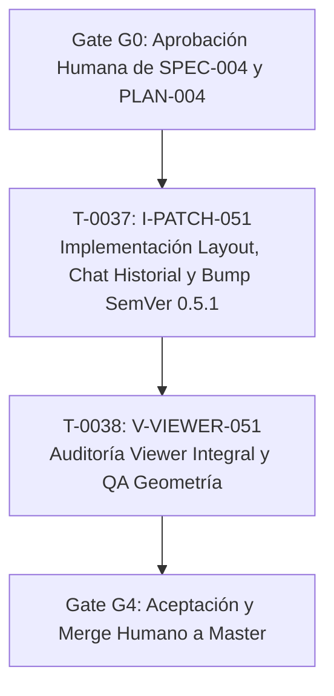

# PLAN-004: Corrección de desborde métricas, jerarquía de chat e historial de conversaciones (0.5.1)

- **Origen**: Instrucción humana en HITL - Tri-Coach (`memory/immediate/handoff.md`), task T-0036.
- **Autonomía**: `hitl` (requiere aprobación humana G0 antes de iniciar la implementación).
- **Versión objetivo**: SemVer `0.5.1` PATCH.

---

## 1. Decisión técnica y alternativas

### Evaluación de alternativas

| Área técnica | Alternativas evaluadas | Complejidad, riesgo, costo y reversibilidad |
|---|---|---|
| **1. Desborde en celda «PUNTUACIÓN DE SUEÑO»** | **A. Reducir tamaño de fuente (`font-size: 0.55rem`) sin tocar grid** vs<br>**B. Abreviar la etiqueta a *"Punt. sueño"* en UI** vs<br>**C. Ajuste integral CSS: `repeat(auto-fit, minmax(7.5rem, 1fr))` + `min-width: 0; overflow: hidden;` + `overflow-wrap: break-word` + `flex-shrink: 0` en badge (Recomendada)** | La opción A deteriora la legibilidad y accesibilidad (WCAG) sin resolver viewports estrechos. La opción B degrada la consistencia de copy del producto y oculta la raíz del problema geométrico. **Opción C recomendada**: complejidad baja, riesgo mínimo, costo de mantenimiento nulo, 100% testeable geométricamente (`scrollWidth <= clientWidth`) y reversible sin impacto lateral. |
| **2. Jerarquía de CoachChat en Inicio** | **A. Modal emergente / botón flotante (FAB)** vs<br>**B. Enlace a pantalla completa sin vista rápida en Inicio** vs<br>**C. Reubicación como primer componente bajo el header con altura acotada a ~22vh-25vh (min 180px, max 28vh), compositor de 2 filas y scroll interno en historial (Recomendada)** | Las opciones A y B alteran la experiencia de acceso instantáneo solicitada por el usuario. **Opción C recomendada**: ubica `<CoachChat />` inmediatamente bajo `<header className="page-header">` y antes de `<TodayCard />`, dimensionándolo de forma compacta para que `<TodayCard />` permanezca visible debajo sin requerir scroll excesivo. Complejidad baja, riesgo bajo, reversible de forma inmediata. |
| **3. Sincronización de token e historial local de chat** | **A. Forzar login obligatorio para cualquier interacción de chat** vs<br>**B. Reinstanciar el ViewModel en cada render de React (`new CoachConversationViewModel` sin memo)** vs<br>**C. Mutabilidad controlada de token vía `vm.setAccessToken(token)` sincronizado con `useEffect`, captura resiliente de errores HTTP, merge deduplicado en presentación de conversaciones remotas y locales (`localStorage["fitness-coach-chats"]`), y respaldo inmediato con `upsertChat` (Recomendada)** | La opción A bloquea a usuarios sin conexión o en modo de prueba local, degradando la experiencia. La opción B provoca recreación continua del estado, reseteo de borradores y loops infinitos de render. **Opción C recomendada**: mantiene el patrón MVVM (ADR-004), permite sincronización reactiva limpia del token JWT, unifica conversaciones locales y remotas para que el usuario nunca pierda acceso a su historial previo, y respalda en `localStorage` ante desconexiones. |
| **4. Estrategia de versionado** | **A. Salto a 0.6.0 MINOR** vs<br>**B. Incremento atómico a 0.5.1 PATCH en Grupo R (Recomendada)** | La opción A infringe SemVer dado que no se introducen nuevas rutas ni features mayores del sistema. **Opción B recomendada**: bump a `0.5.1` PATCH sincronizado en `package.json`, `package-lock.json`, `README.md`, `CHANGELOG.md` y `version.test.mjs`. |

---

### ADR propuesto

```markdown
# ADR-008: Corrección geométrica de celdas métricas, jerarquía compacta de chat en Inicio y sincronización reactiva local-remota de historial

- Estado: propuesto
- Fecha: 2026-10-17
- Task: T-0036 (especificación), dependiente de aprobación G0

## Contexto
En la versión 0.5.0 de Tri-Coach, la inspección en producción reveló tres fricciones críticas:
1. La celda «PUNTUACIÓN DE SUEÑO» desborda horizontalmente forzando el badge '✓' sobre la tarjeta contigua 'HRV' debido a columnas mínimas de 5.5rem, falta de 'min-width: 0' y falta de 'overflow-wrap: break-word'.
2. CoachChat se encontraba al fondo de la página de Inicio tras tres tarjetas operativas completas, cuando el atleta requiere interactuar con el entrenador de inmediato.
3. El historial de conversaciones en Inicio y ChatScreen aparecía vacío por: (a) token congelado en null dentro de CoachConversationViewModel; (b) fallo silencioso en loadConversations(); y (c) omisión de conversaciones locales supervivientes en localStorage["fitness-coach-chats"].

## Decisión
1. Adoptar en apps/web/app/globals.css un dimensionamiento geométrico robusto para .metrics-grid con repeat(auto-fit, minmax(7.5rem, 1fr)), contención flexible en .metric-cell (min-width: 0; overflow: hidden;), alineación vertical flexible en .metric-label-row (align-items: flex-start; gap: 0.35rem; min-width: 0;), quiebre seguro de palabra indivisible en .metric-label (overflow-wrap: break-word; line-height: 1.25; min-width: 0; flex: 1 1 auto;), y flex-shrink: 0 en .metric-status-badge, asegurando scrollWidth <= clientWidth en todo viewport entre 375px y 1600px.
2. Reordenar apps/web/app/(dashboard)/page.tsx colocando <CoachChat /> como primer componente interactivo tras <header className="page-header"> y antes de <TodayCard />, con estilos acotados a ~22vh-25vh (min-height: 180px, max-height: 28vh), compositor de 2 filas y scroll interno en historial, garantizando la visibilidad de TodayCard inmediatamente debajo.
3. Actualizar apps/web/hooks/useCoachConversation.ts para permitir la actualización reactiva del token JWT vía setAccessToken(token), capturar errores HTTP en loadConversations() sin excepciones no controladas, realizar merge deduplicado de conversaciones remotas con las locales supervivientes en localStorage en CoachChat.tsx y CoachChatScreen.tsx, y persistir respaldo inmediato con upsertChat al enviar mensajes.
4. Incrementar la versión del sistema a 0.5.1 PATCH de forma atómica en el Grupo R.

## Consecuencias
- Desborde visual corregido al 100% en todas las resoluciones móviles y desktop.
- Experiencia de usuario inmediata con el Coach sin sacrificar la visión de las métricas de Hoy.
- Acceso transparente y sin pérdida a las conversaciones previas del usuario en el navegador y en la nube.
- 0 migraciones SQL y 0 cambios en el backend de Python.
```

---

## 2. Componentes, capas y contrato técnico (Clean Architecture P22)

### Asignación de capas (`memory/long/standards.md`)

| Capa arquitectónica | Archivo / Componente | Responsabilidad | Dependencias permitidas |
|---|---|---|---|
| **Dominio web** | `apps/web/lib/coachStorage.ts` | Funciones puras de cálculo de digest, serialización, lectura y escritura segura en `localStorage` (`getSurvivingLegacyChats`, `loadChats`, `saveChats`, `upsertChat`). | TypeScript stdlib; cliente de almacenamiento estándar. |
| **Presentación web (ViewModel / Hook)** | `apps/web/hooks/useCoachConversation.ts` | Estado y lógica de presentación interactiva (MVVM). Contiene la clase `CoachConversationViewModel` con sincronización reactiva de `accessToken`, manejo de estados de carga, error y llamadas a API. | Contratos de dominio de chat, React hooks (`useState`, `useRef`, `useEffect`, `useCallback`). |
| **Presentación web (Componentes UI)** | `apps/web/components/TodayCard.tsx` | Tarjeta de métricas de Hoy con cuadrícula `.metrics-grid` y celdas semánticas accesibles. | React, tipos de métricas de dominio. |
| **Presentación web (Componentes UI)** | `apps/web/components/CoachChat.tsx` | Vista rápida compacta de chat en Inicio con compositor de 2 filas y listado unificado de conversaciones. | `useCoachConversation`, `coachStorage.ts`, Next.js routing/links. |
| **Presentación web (Componentes UI)** | `apps/web/components/CoachChatScreen.tsx` | Pantalla completa de chat con panel lateral de historial unificado, modal opt-in de importación y persistencia local de respaldo. | `useCoachConversation`, `coachStorage.ts`, `ClientAuthService`. |
| **Presentación web (Página)** | `apps/web/app/(dashboard)/page.tsx` | Server Component de Inicio que orquesta la jerarquía visual situando `<CoachChat />` antes de `<TodayCard />`. | Server helpers de `lib/`, componentes UI. |
| **Presentación web (Estilos)** | `apps/web/app/globals.css` | Reglas de maquetación CSS, contención geométrica de celdas métricas y dimensionamiento de ~22vh-25vh de `.coach-chat`. | CSS nativo estándar. |

---

### Contratos e interfaces TypeScript

#### 1. Mutabilidad reactiva de token en `CoachConversationViewModel` (`apps/web/hooks/useCoachConversation.ts`)

```typescript
export class CoachConversationViewModel implements CoachConversationState {
  // Propiedad privada mutable para permitir actualización reactiva
  private accessToken: string | null;

  constructor(options: UseCoachConversationOptions = {}) {
    this.accessToken = options.accessToken ?? null;
    // ... inicialización de estado ...
  }

  // Método de sincronización reactiva cuando la sesión resuelve el token JWT
  setAccessToken(token: string | null): void {
    if (this.accessToken !== token) {
      this.accessToken = token;
      this.notify();
    }
  }

  // loadConversations maneja cleanly respuestas no-ok sin fallar silenciosamente
  async loadConversations(options: { offset?: number; limit?: number } = {}): Promise<void> {
    const limit = options.limit ?? 20;
    const offset = options.offset ?? 0;
    this.isLoading = true;
    this.notify();

    try {
      const fetchFn = this.getFetch();
      const res = await fetchFn(
        `${this.apiBaseUrl}/api/conversations?limit=${limit}&offset=${offset}`,
        {
          headers: this.getAuthHeaders(),
        }
      );

      if (res.ok) {
        const body = (await res.json()) as {
          ok?: boolean;
          conversations?: ConversationViewModel[];
          total?: number;
        };
        if (body.ok && Array.isArray(body.conversations)) {
          if (offset === 0) {
            this.conversations = body.conversations;
          } else {
            this.conversations = [...this.conversations, ...body.conversations];
          }
          this.totalConversations = body.total ?? this.conversations.length;
        }
      } else if (res.status === 401) {
        // Sesión no autenticada en nube: no es crash, permite continuar con almacenamiento local
        this.error = null;
      } else {
        const errBody = (await res.json().catch(() => ({}))) as { error?: string };
        this.error = errBody.error || `Error del servidor (${res.status})`;
      }
    } catch (err) {
      this.error = err instanceof Error ? err.message : "Error al cargar conversaciones";
    } finally {
      this.isLoading = false;
      this.notify();
    }
  }
}

// En el hook useCoachConversation:
export function useCoachConversation(options: UseCoachConversationOptions = {}) {
  // ...
  const vm = vmRef.current;

  // Sincronización reactiva del accessToken cuando cambia en el cliente
  useEffect(() => {
    vm.setAccessToken(options.accessToken ?? null);
  }, [options.accessToken, vm]);

  // ...
}
```

#### 2. Deduplicación y merge unificado de conversaciones en presentación (`CoachChat.tsx` y `CoachChatScreen.tsx`)

```typescript
// Unificación en presentación: combina conversaciones remotas con locales supervivientes
export function mergeConversations(
  remote: ConversationViewModel[],
  local: StoredChat[]
): Array<{ id: string; title: string; updatedAt?: string; isLocal?: boolean }> {
  const remoteIds = new Set(remote.map((c) => c.id));
  const merged: Array<{ id: string; title: string; updatedAt?: string; isLocal?: boolean }> = [
    ...remote.map((r) => ({ id: r.id, title: r.title, updatedAt: r.updatedAt, isLocal: false })),
  ];

  for (const l of local) {
    if (!remoteIds.has(l.id)) {
      merged.push({
        id: l.id,
        title: l.title || "Conversación en este dispositivo",
        updatedAt: l.updatedAt,
        isLocal: true,
      });
    }
  }

  // Ordenar descendentemente por fecha de actualización
  return merged.sort((a, b) => {
    const timeA = a.updatedAt ? new Date(a.updatedAt).getTime() : 0;
    const timeB = b.updatedAt ? new Date(b.updatedAt).getTime() : 0;
    return timeB - timeA;
  });
}
```

#### 3. Apertura de conversación local y respaldo inmediato en `localStorage` (`CoachChatScreen.tsx`)

```typescript
// Al cargar mensajes: si la API retorna 401 o falla, intentar cargar desde localStorage
// Al enviar o recibir mensajes: respaldar inmediatamente en localStorage
if (typeof window !== "undefined") {
  upsertChat({
    id: conversationId,
    title: activeTitle,
    updatedAt: new Date().toISOString(),
    messages: allMessages.map((m) => ({ role: m.role, content: m.content })),
  });
}
```

#### 4. Reglas CSS canónicas para celdas métricas y chat compacto (`apps/web/app/globals.css`)

```css
/* Corrección geométrica celda métricas (REQ-001, REQ-002) */
.metrics-grid {
  display: grid;
  grid-template-columns: repeat(auto-fit, minmax(7.5rem, 1fr));
  gap: 0.5rem;
  margin-top: 0.75rem;
}

.metric-cell {
  background: #0f172a;
  border-radius: 8px;
  padding: 0.5rem 0.65rem;
  border-left: 3px solid var(--muted);
  min-width: 0;
  overflow: hidden;
}

.metric-label-row {
  display: flex;
  align-items: flex-start;
  justify-content: space-between;
  gap: 0.35rem;
  min-width: 0;
}

.metric-label {
  display: block;
  min-width: 0;
  flex: 1 1 auto;
  overflow-wrap: break-word;
  word-break: break-word;
  line-height: 1.25;
  font-size: 0.7rem;
  color: var(--muted);
  text-transform: uppercase;
  letter-spacing: 0.03em;
}

.metric-status-badge {
  flex-shrink: 0;
  font-size: 0.75rem;
  font-weight: 700;
  line-height: 1;
}

/* Dimensionamiento compacto de CoachChat en Inicio (REQ-004) */
.coach-chat {
  display: flex;
  flex-direction: column;
  margin-bottom: 1.25rem;
  max-height: 28vh;
  min-height: 180px;
}

.coach-composer textarea {
  width: 100%;
  resize: none;
  min-height: 2.75rem;
  height: 2.75rem;
  border: 0;
  background: transparent;
  color: var(--text);
  font: inherit;
  outline: none;
  line-height: 1.35;
}

.coach-history {
  list-style: none;
  margin: 0;
  padding: 0;
  display: flex;
  flex-direction: column;
  gap: 0.35rem;
  overflow-y: auto;
  max-height: 120px;
}
```

---

## 3. Dimensionamiento del equipo y autonomía

- **Autonomía**: `hitl` (Gate G0 para aprobar esta especificación y plan; Gate G4 para aceptación y merge a `master`).
- **Tamaño de equipo**: **S ajustado** (1 Implementer para resolver el patch y release en Grupo R, 1 Viewer independiente en solo lectura, y el Coordinator).
- **Justificación**:
  - Las correcciones están estrictamente circunscritas a componentes de frontend en `apps/web/`, estilos CSS y hooks de estado.
  - Al no haber concurrencia de múltiples desarrolladores, un único implementer ejecuta el paquete de forma coherente bajo perfil `fast-track` (rutinaria, bajo riesgo, reversible, tests-first).
  - La inclusión de los archivos del Grupo R (`package.json`, `package-lock.json`, `README.md`, `CHANGELOG.md`, `version.test.mjs`) en la allowlist del implementer único previene cualquier fragmentación de tareas y garantiza el bump atómico a `0.5.1`.

---

## 4. Descomposición en tasks y allowlists

Todas las tasks hijas tienen `parent_task: T-0036`.



### Tabla de tasks propuestas

| Task ID (alias) | Destino | REQ cubiertos | Allowlist de archivos | Depende de | Perfil |
|---|---|---|---|---|---|
| **T-0037**<br>`(I-PATCH-051)` | implementer | REQ-001..<br>REQ-009 | `apps/web/app/globals.css`<br>`apps/web/components/TodayCard.tsx`<br>`apps/web/app/(dashboard)/page.tsx`<br>`apps/web/components/CoachChat.tsx`<br>`apps/web/components/CoachChatScreen.tsx`<br>`apps/web/hooks/useCoachConversation.ts`<br>`apps/web/lib/coachStorage.ts`<br>`apps/web/package.json`<br>`apps/web/package-lock.json`<br>`apps/web/README.md`<br>`apps/web/CHANGELOG.md`<br>`apps/web/lib/version.test.mjs`<br>`apps/web/tests/patch-layout-chat/*.test.mjs`<br>`apps/web/lib/patch-layout-chat.test.mjs`<br>`deliverables/T-0037.md` | Gate G0 aprobado por humano | fast-track |
| **T-0038**<br>`(V-VIEWER-051)` | viewer | Todos<br>(REQ-001..009) | Solo lectura (`deliverables/T-0038.md`) | T-0037 completada | riguroso |

---

## 5. Matriz de trazabilidad EARS y pruebas tests-first

| REQ ID | Patrón | Task ejecutora | Suite de prueba / Comprobación | Evidencia esperada |
|---|---|---|---|---|
| **REQ-001** | Ubicuo | T-0037 | `tests/patch-layout-chat/metrics-geometry.test.mjs` (P01) | Test geométrico valida que para la celda `PUNTUACIÓN DE SUEÑO`, `scrollWidth <= clientWidth` en 375px, 390px, 414px, 768px, 800px, 1024px, 1120px, 1440px y 1600px. |
| **REQ-002** | Ubicuo | T-0037 | `tests/patch-layout-chat/metrics-geometry.test.mjs` (P02) | Test de CSS verifica presencia de `minmax(7.5rem, 1fr)`, `min-width: 0; overflow: hidden;`, `overflow-wrap: break-word` y `flex-shrink: 0`. |
| **REQ-003** | Ubicuo | T-0037 | `tests/patch-layout-chat/layout-hierarchy.test.mjs` (P03) | Test de estructura JSX en `page.tsx` verifica que `<CoachChat />` precede inmediatamente a `<TodayCard />` bajo el encabezado. |
| **REQ-004** | Estado | T-0037 | `tests/patch-layout-chat/layout-hierarchy.test.mjs` (P04) | Test de CSS comprueba cotas de altura en `.coach-chat` (min 180px, max 28vh), textarea `rows={2}` y scroll en `.coach-history`. |
| **REQ-005** | Evento | T-0037 | `tests/patch-layout-chat/viewmodel-token-sync.test.mjs` (P05) | Test unitario comprueba que `setAccessToken(token)` actualiza los headers con `Authorization: Bearer <token>` y reactiva la carga remota. |
| **REQ-006** | No deseado | T-0037 | `tests/patch-layout-chat/viewmodel-token-sync.test.mjs` (P06) | Test unitario valida manejo limpio de respuestas 401 y errores de red sin excepciones no capturadas. |
| **REQ-007** | Ubicuo | T-0037 | `tests/patch-layout-chat/history-merge.test.mjs` (P07) | Test de integración comprueba deduplicación y merge correcto de conversaciones locales y remotas en `CoachChat` y `CoachChatScreen`. |
| **REQ-008** | Evento | T-0037 | `tests/patch-layout-chat/history-merge.test.mjs` (P08) | Test de almacenamiento valida que el envío de mensajes ejecuta `upsertChat` en `localStorage["fitness-coach-chats"]`. |
| **REQ-009** | Ubicuo | T-0037 | `apps/web/lib/version.test.mjs` (P09) | Suite de versión valida `0.5.1` en `package.json`, `package-lock.json`, `README.md` y entrada en `CHANGELOG.md`. |

---

## 6. Verificación global

Para verificar completamente la entrega del implementer, se ejecutan de manera reproducible:

1. **Suite de pruebas unitarias y de integración**:
   ```bash
   npm test --prefix apps/web
   ```
   *Criterio de éxito*: Pasan todos los tests (mínimo 91 tests: 82 existentes + 9 nuevos de P01-P09) con 0 fallos.

2. **Compilación estática de producción Next.js 15**:
   ```bash
   npm run build --prefix apps/web
   ```
   *Criterio de éxito*: Build limpio, 0 errores de tipado TypeScript y código de salida 0.

3. **Verificación de gobierno y arquitectura SDD**:
   ```bash
   IES_ACTOR=viewer ies memory validate
   IES_ACTOR=viewer ies constitution check
   ```
   *Criterio de éxito*: 0 BLOCKING, 0 NON_BLOCKING no autorizados.

---

## 7. Rollback

### Rollback por task individual
- En caso de fallo o regresión durante `T-0037`, se descarta el worktree de forma aislada:
  ```bash
  git worktree remove --force .ies/worktrees/T-0037
  git branch -D task/T-0037
  ```

### Rollback global posterior a la integración
- Dado que este patch no realiza migraciones destructivas ni altera bases de datos:
  - Se puede revertir mediante un commit regular hacia adelante: `git revert -m 1 <merge_commit_sha>`.
  - La aplicación web regresa a la versión `0.5.0` sin requerir acciones sobre Supabase ni backend Python.

---

## 8. Entrega a producción — ejecución humana

> [!CAUTION]
> **Prohibición estricta para agentes**: Ningún agente de IA (coordinator, planner, implementer, viewer) tiene permitido realizar git push a `origin/master`, deploy a Vercel ni mutar la base de datos de producción. La entrega a producción es ejecutada exclusivamente por el operador humano tras la aprobación de los gates.

### Procedimiento paso a paso para el humano

1. **Precondiciones de release**:
   - T-0038 (`V-VIEWER-051`) finalizado con veredicto canónico formal `APROBAR` sin hallazgos BLOCKING.
   - Suite completa en verde (`npm test --prefix apps/web` -> PASS con 0 fallos).
   - Build de producción verificado (`npm run build --prefix apps/web` -> código 0).
   - Gate G4 de aceptación humana completado en sesión HITL.

2. **Revisión de versión y CHANGELOG**:
   - Verificar que `apps/web/package.json` declara `"version": "0.5.1"`.
   - Verificar que `apps/web/CHANGELOG.md` documenta la versión `0.5.1` con la descripción de:
     - Corrección geométrica de desborde en celda `PUNTUACIÓN DE SUEÑO` (`scrollWidth <= clientWidth`).
     - Reubicación de `CoachChat` al inicio ocupando el primer cuarto de la pantalla (~22vh-25vh).
     - Sincronización reactiva de token, manejo de fallos y unificación con historial local superviviente en `localStorage`.

3. **Migraciones de base de datos**:
   - **Ninguna migración SQL requerida**: Los cambios son 100% de cliente web y estilos.

4. **Fusión y despliegue a producción**:
   - Fusión manual de la rama integrada hacia `master`:
     ```bash
     git checkout master
     git merge --no-ff task/T-0037-patch
     git push origin master
     ```
   - Vercel desplegará automáticamente la versión `0.5.1` en la URL de producción.

5. **Verificación post-despliegue (Smoke Test humano en producción)**:
   - Abrir la URL de Tri-Coach en Safari desktop y navegador móvil (Safari iOS / Chrome Android).
   - En la página de Inicio:
     - Confirmar que `CoachChat` aparece arriba inmediatamente bajo el encabezado, ocupando aproximadamente el 25% de la pantalla.
     - Confirmar que la tarjeta `TodayCard` es visible inmediatamente debajo sin scroll excesivo.
     - Confirmar que en la tarjeta de Hoy la celda «PUNTUACIÓN DE SUEÑO» muestra el texto partido en dos líneas sin solapar el check `✓` sobre la tarjeta contigua de `HRV`.
     - Confirmar que «Últimas conversaciones» muestra las conversaciones guardadas previamente en el navegador.
     - Escribir una pregunta en el chat y presionar Enviar: verificar que abre `/chat?conversation=<id>`, responde correctamente y persiste el mensaje.
   - En la pantalla `/chat`:
     - Abrir el panel de Historial y verificar que se visualizan las conversaciones disponibles.

6. **Observabilidad en operación**:
   - Monitorear logs de Vercel durante 15 minutos:
     - 0 errores 500 en rutas `/` y `/chat`.
     - Tasa de respuestas 200 en `/api/conversations` y `/api/chat`.

7. **Criterio de reversión inmediata**:
   - Si se presenta un error crítico de renderizado o desborde imprevisto en producción:
     - En el dashboard de Vercel, ejecutar *Rollback* instantáneo a la versión productiva previa (`0.5.0`).
     - Revertir el commit en `master` y notificar a Coordinator.
